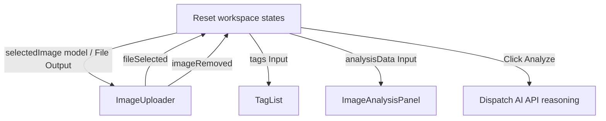

# Design System: Hybrid Image Analysis (Firebase AI Logic)

This document outlines the design system, brand identity, and structural layout for the **Hybrid Image Analysis** application. The main design system configurations and Tailwind CSS v4 `@theme static` block are located in [src/styles.css](src/styles.css), accompanied by global layout and card primitives in [src/layout.css](src/layout.css) and [src/section-card.css](src/section-card.css).

---

## 1. Atmosphere & Brand Identity

The brand identity centers on **Firebase AI Logic**, projecting a sense of security, intelligence, and high-performance computing.

- **Aesthetic Tone**: Corporate, modern, and leaning heavily toward minimalism.
- **Visual Elements**:
  - **Clean Canvas Backdrop**: High-contrast light surface (`--color-surface`: `#f8f9ff`) paired with crisp white cards (`--color-surface-card`: `#ffffff`).
  - **Tactile Glassmorphic Layers**: Modern translucent panels (`.section-card` in [src/section-card.css](src/section-card.css)) using subtle borders (`--color-surface-glass-border`) and soft background blur (`backdrop-blur-md`).
  - **Zero-Dependency Standalone Icons**: 12 standalone SVG icon components styled globally via `.app-icon` and `.app-icon > svg` in [src/styles.css](src/styles.css).

---

## 2. Color Roles & Tokens

The color palette is defined in a single `@theme static` block in [src/styles.css](src/styles.css). All transparency is strictly declared using 8-digit hex notation (`#rrggbbaa`).

### Core Brand, Metric & Surface Roles

| Token Name           | CSS Variable                 | Hex Value | Role / Usage                                                              |
| :------------------- | :--------------------------- | :-------- | :------------------------------------------------------------------------ |
| `primary`            | `--color-primary`            | `#6366f1` | Primary branding, buttons, active interactive states, input tokens        |
| `on-primary`         | `--color-on-primary`         | `#ffffff` | High-contrast text on primary buttons and badges                          |
| `secondary`          | `--color-secondary`          | `#0f172a` | Authoritative text colors, tooltips, hero shadow, output/image token bars |
| `tertiary`           | `--color-tertiary`           | `#10b981` | Cached token segments and positive efficiency metrics                     |
| `quaternary`         | `--color-quaternary`         | `#f59e0b` | Thought/reasoning token segments                                          |
| `surface`            | `--color-surface`            | `#f8f9ff` | Application canvas backdrop and form control background                   |
| `surface-card`       | `--color-surface-card`       | `#ffffff` | Opaque card surfaces (uploaders, canvas preview, PWA banner)              |
| `surface-container`  | `--color-surface-container`  | `#e5eeff` | Interactive hover surfaces, tag pills, progress tracks, dropzones         |
| `on-surface`         | `--color-on-surface`         | `#0b1c30` | Main text color on surfaces                                               |
| `on-surface-variant` | `--color-on-surface-variant` | `#464554` | Subdued descriptive text                                                  |
| `outline`            | `--color-outline`            | `#767586` | Low-contrast borders, placeholders, and section subtitles                 |
| `outline-variant`    | `--color-outline-variant`    | `#c7c4d7` | Muted division lines and container borders                                |

### Semantic Error, Glassmorphism & Utility Tokens

| Token Name             | CSS Variable                    | Value       | Role / Usage                                        |
| :--------------------- | :------------------------------ | :---------- | :-------------------------------------------------- |
| `error`                | `--color-error`                 | `#ef4444`   | High-visibility alert states and destructive hovers |
| `error-container`      | `--color-error-container`       | `#ef44441a` | 10% opacity backdrop for error banners              |
| `error-border`         | `--color-error-border`          | `#ef444433` | 20% opacity border for error containers             |
| `error-text`           | `--color-error-text`            | `#fca5a5`   | Error banner headline text                          |
| `error-text-muted`     | `--color-error-text-muted`      | `#f87171`   | Secondary error messages and error icons            |
| `surface-glass`        | `--color-surface-glass`         | `#ffffffb3` | 70% opacity glass card and status badge background  |
| `surface-glass-border` | `--color-surface-glass-border`  | `#d3e4fe80` | 50% opacity subtle glass panel border               |
| `skeleton`             | `--color-skeleton`              | `#64748b`   | Placeholder loading shimmer fill                    |
| `container-max`        | `--spacing-container-max`       | `1280px`    | Maximum horizontal container constraint             |
| `transition-duration`  | `--default-transition-duration` | `200ms`     | Default CSS transition timing across interactive UI |

---

## 3. Typography & Global Icon Primitives

Typography uses a zero-dependency 2-tier system font hierarchy in `@theme static` ([src/styles.css](src/styles.css#L28-L29)) designed to maximize rendering speed and eliminate network font downloads:

1. **`--font-sans`** (`'Inter', ui-sans-serif, system-ui, sans-serif`): Default `html, :host` font family, headlines, and body prose.
2. **`--font-mono`** (`ui-monospace, SFMono-Regular, Menlo, Monaco, Consolas, monospace`): Numeric metrics, badges, token counters, and streaming status labels.

### Canonical Typography Utility Mappings

| Role / Element                 | Selector / Location          | Tailwind CSS v4 Utilities                                            |
| :----------------------------- | :--------------------------- | :------------------------------------------------------------------- |
| **Hero Display Heading**       | `<h1>` (`home`)              | `text-3xl md:text-5xl lg:text-6xl font-bold`                         |
| **Section Title**              | `.section-title` (global)    | `text-xl font-bold flex items-center gap-2 tracking-tight`           |
| **Section Subtitle / Label**   | `.section-subtitle` (global) | `text-xs font-bold uppercase tracking-widest text-outline block`     |
| **Card / Dish Headline**       | Accordion & Banner titles    | `text-lg font-semibold` or `text-base font-semibold text-on-surface` |
| **Lead / Body Copy**           | Hero & Panel descriptions    | `text-lg` or `text-sm text-on-surface-variant`                       |
| **Monospace Status & Metrics** | Badges & Token counters      | `font-mono text-xs font-bold`                                        |

### Global SVG Icon Rules (`.app-icon`)

Defined in [src/styles.css](src/styles.css#L61-L67), all 12 standalone icon components (`src/app/shared/ui/icons/`) bind `class="app-icon size-5"` on their host element:

```css
.app-icon {
  @apply inline-flex items-center justify-center shrink-0 select-none;
}

.app-icon > svg {
  @apply size-full;
}
```

---

## 4. Global Shell, Section Cards & Home Layout

Global layout and section-card primitives are separated into [src/layout.css](src/layout.css) and [src/section-card.css](src/section-card.css) (imported at the bottom of [src/styles.css](src/styles.css)).

### 4.1 Global Section Card Primitives (`src/section-card.css`)

| Class               | `@apply` Rule in `src/section-card.css`                                                       | Usage                                                         |
| :------------------ | :-------------------------------------------------------------------------------------------- | :------------------------------------------------------------ |
| `.panel-container`  | `@apply mt-8 animate-fade-in;`                                                                | Outer wrapper for deferred feature panels                     |
| `.section-card`     | `@apply p-6 rounded-xl bg-surface-glass backdrop-blur-md border border-surface-glass-border;` | Standard glassmorphic card container and `@placeholder` box   |
| `.section-title`    | `@apply text-xl font-bold flex items-center gap-2 tracking-tight;`                            | Primary section/card heading with leading icon                |
| `.section-subtitle` | `@apply text-xs font-bold uppercase tracking-widest text-outline block;`                      | Overline label for sections, form controls, and metric splits |

### 4.2 Global Header & Footer Primitives (`src/layout.css`)

1. **Top Navigation Bar (`<app-header>` & `src/layout.css`)**:
   - Host binding: `block sticky top-0 z-50`.
   - `.nav-bar`: `@apply border-b border-outline-variant/30 bg-primary text-on-primary;` (paired with `backdrop-blur-md w-full` in template).
   - `.nav-container`: `@apply flex justify-between items-center h-16 max-w-container-max;` (paired with `px-6 mx-auto`).
   - `.nav-brand-title`: `@apply flex items-center md:text-xl;` (paired with `font-bold gap-2`, displaying `<app-terminal-icon />` and `<span class="hidden sm:inline">{{ title() }}</span>`).
   - `.nav-links`: `@apply flex gap-6 lg:gap-8 text-sm md:text-base lg:text-lg;` (paired with `font-medium items-center`).
   - `.nav-link`: `@apply text-on-primary/80 hover:text-on-primary;` (paired with `transition-colors py-1`).
   - `.nav-link-active`: `@apply text-on-primary font-bold border-b-2 border-on-primary;`.
2. **Footer (`<app-footer>` & `src/layout.css`)**:
   - `.footer-bar`: `@apply bg-primary text-on-primary py-8;` (paired with `w-full mt-auto`).
   - `.footer-container`: `@apply max-w-container-max flex flex-col md:flex-row justify-between items-center gap-4;` (paired with `mx-auto px-6`).
   - `.footer-copyright`: `@apply text-center md:text-left text-sm md:text-lg;` (paired with `text-on-primary/80`).

### 4.3 Home Hero Section (`home.component.css`)

- **Stylesheet ([home.component.css](src/app/features/home/home.component.css))**:
  - `.hero-container`: `@apply mx-auto px-6 grid md:grid-cols-12 gap-10 md:gap-16 items-center py-12 md:py-16;` (paired with `w-full max-w-7xl` inside `<section class="flex-1 flex items-center">`).
  - **Inline Left-Column Content ([home.component.html](src/app/features/home/home.component.html))**: Uses `<div class="md:col-span-7 space-y-6 md:space-y-8">` wrapping `<h1 class="text-3xl md:text-5xl lg:text-6xl font-bold">` and `<p class="text-lg text-on-surface-variant max-w-xl">`.
  - `.hero-cta-btn`: `@apply inline-flex items-center gap-2 bg-surface-card text-primary px-6 py-3 rounded-xl hover:bg-surface-container;` (paired with `font-semibold shadow-lg`).
  - **Inline Hero Visual & Image ([home.component.html](src/app/features/home/home.component.html))**: Right-column container uses `<div class="md:col-span-5 max-w-[480px] mx-auto">`, wrapping ``.

### 4.4 PWA Update Notification Banner (`pwa-update-banner.component.css`)

- **Stylesheet ([pwa-update-banner.component.css](src/app/pwa/pwa-update-banner/pwa-update-banner.component.css))**:
  - `.pwa-banner-card`: `@apply fixed bottom-6 right-6 z-50 flex flex-col gap-4 p-5 rounded-2xl bg-surface-card border-outline-variant w-[360px] max-w-[calc(100vw-48px)];` (paired with `border shadow-lg`; header row `<div class="flex items-center gap-4">` vertically centers the icon badge and `<h4 class="font-semibold">`).
  - `.pwa-banner-badge-wrapper`: `@apply flex items-center justify-center p-2.5 rounded-xl;` (paired with `bg-primary/10 shrink-0` wrapping `<app-download-icon class="text-primary" />`).
  - `.pwa-banner-actions`: `@apply flex justify-end gap-3;` (paired with `font-bold text-xs` in `<div class="font-bold text-xs pwa-banner-actions">` so child buttons inherit `font-bold` and `text-xs`).
  - `.pwa-banner-btn`: `@apply px-4 py-2 rounded-lg cursor-pointer;` (paired with `text-on-surface-variant hover:text-on-surface hover:bg-surface-container` on the secondary button and `text-on-primary bg-primary hover:bg-primary/90` on the primary button).

---

## 5. Streaming Loader & Progressive Visual States

To accommodate real-time generative streams and background model initialization, the design system defines progressive layout primitives in [src/styles.css](src/styles.css) and [image-analysis.component.css](src/app/features/image-analysis/image-analysis.component.css).

### 5.1 Image Analysis Workspace & Streaming Loader Badge (`image-analysis.component.css`)

- **Workspace & Action Primitives**:
  - `.workspace-container`: `@apply max-w-container-max px-4 py-8;` (paired with `space-y-6 mx-auto` in template).
  - `.primary-action-btn`: `@apply flex items-center gap-2 bg-primary text-on-primary px-6 py-3 rounded-xl;` (paired with `shadow-lg hover:opacity-95 active:scale-95 transition-all`, wrapping `<span class="font-semibold">`).
  - `.error-banner`: `@apply flex items-center gap-4 bg-error-container border-error-border p-4 rounded-2xl mx-auto my-6 max-w-5xl;` (paired with `border backdrop-blur-sm`).
- **Glassmorphic Streaming Loader Badge (`.streaming-loader-badge`)**:
  - `@apply flex px-4 items-center gap-2.5 py-1.5 bg-surface-glass border-surface-glass-border text-on-surface-variant;` (paired with `rounded-full border` in template).
  - Reused for both active inference streaming (`<app-sync-icon class="text-primary size-5" />`) and background on-device pre-warming (`<app-sync-icon class="text-primary size-4" />`) alongside `<span class="text-xs font-bold font-mono">`.

### 5.2 Progressive Content Reveal Animation (`.animate-fade-in`)

All progressive elements (including newly rendered tag lists and `.panel-container`) use the global `animate-fade-in` utility defined in [src/styles.css](src/styles.css#L46-L59):

```css
@keyframes fadeIn {
  from {
    opacity: 0;
    transform: translateY(10px);
  }
  to {
    opacity: 1;
    transform: translateY(0);
  }
}

@utility animate-fade-in {
  animation: fadeIn 0.35s cubic-bezier(0.16, 1, 0.3, 1) forwards;
}
```

### 5.3 CLS-Safe On-Device Pre-Warming Status Slot (`.prewarm-status-slot`)

When `ImageAnalysisComponent` triggers background Gemini Nano pre-warming after initial render (`afterNextRender`), a dedicated status slot sits directly below `<app-image-uploader class="mb-0">`:

- **Zero-CLS Layout Slot (`.prewarm-status-slot`)**:
  - Stylesheet rule: `@apply flex items-center justify-center;` in [image-analysis.component.css](src/app/features/image-analysis/image-analysis.component.css).
  - Template binding: `<div class="prewarm-status-slot min-h-9 my-0" role="status" aria-live="polite">`.
  - Reserves a fixed minimum height (`min-h-9` / `36px`) with zero vertical margin (`my-0`), acting as the single spacing gap between `<app-image-uploader class="mb-0">` and the next workspace element so mounting and unmounting `.streaming-loader-badge` produces `0.000` Cumulative Layout Shift (CLS).

---

## 6. Image Analysis Feature Architecture

The Image Analysis workspace orchestrates the `ImageUploader`, `TagList`, and `ImageAnalysisPanel` into a cohesive, responsive workspace with progressive streaming support.

### 6.1 Orchestration Architecture



### 6.2 Workspace & Advanced Analysis Panel (4-Tab Control System)

#### Shared Uploader & Tag Badge Primitives

- **Image Uploader ([image-uploader.component.css](src/app/shared/ui/image-uploader/image-uploader.component.css))**:
  - `.error-banner`: `@apply absolute -top-12 left-0 right-0 text-center;`
  - `.error-banner-text`: `@apply bg-error-container text-error-text-muted text-sm px-4 py-2 rounded-full border-error-border;`
  - `.uploader-panel`: `@apply relative min-h-[300px] flex flex-col items-center justify-center cursor-pointer rounded-xl overflow-hidden;`
  - `.preview-image`: `@apply w-full h-auto max-h-[450px];`
  - `.remove-btn`: `@apply absolute top-4 right-4 bg-secondary/80 text-on-primary p-2.5 rounded-lg opacity-0 flex items-center justify-center;` (reveals on `.uploader-panel:hover .remove-btn` with `@apply opacity-100;`, transitions to `@apply bg-error;` on `.remove-btn:hover`).
- **Tag Badge & Hover Tooltip ([badge.component.css](src/app/shared/ui/components/badge/badge.component.css))**:
  - `.tag-pill`: `@apply text-sm px-4 py-2 rounded-full cursor-pointer;`
  - `.tooltip-wrapper`: `@apply absolute bottom-full left-0 mb-2 opacity-0;` (reveals via `.group:hover .tooltip-wrapper` with `@apply opacity-100;`)
  - `.tooltip-content`: `@apply text-sm px-3.5 py-2.5 rounded-lg w-64;`
  - `.tooltip-arrow`: `@apply absolute left-4 top-full;`
- **Tab Group Header ([tab-group.component.css](src/app/shared/ui/components/tab-group/tab-group.component.css))**:
  - `.tabs-header-list`: `@apply flex mb-8 overflow-x-auto;` with `scrollbar-width: none;` and `.tabs-header-list::-webkit-scrollbar { display: none; }`
  - `.tab-header-btn`: `@apply whitespace-nowrap px-6 py-3 text-sm outline-none;` (paired with `border-b-2 cursor-pointer` in [tab-group.component.html](src/app/shared/ui/components/tab-group/tab-group.component.html))

#### 4-Tab Control System

The results section employs a 4-tab control system allowing users to deep-dive into multi-modal metadata:

1. **Thought Summary**:
   - Card utilizing `.section-card` glassmorphic aesthetics (`var(--color-surface-glass)` and `var(--color-surface-glass-border)`).
   - Presents AI reasoning steps, model confidence scores, and structured insights (e.g. breed detection, environmental context, lighting conditions).
2. **Recommendations List ([recommendation-list.component.css](src/app/shared/ui/components/recommendation-list/recommendation-list.component.css) & [recommendation-item.component.css](src/app/shared/ui/components/recommendation-list/recommendation-item.component.css))**:
   - Structured list of composition, visual, and lighting suggestions (e.g. cropping guidelines, color balance shifts).
   - `.recommendation-list-title`: `@apply flex items-center gap-2;`
   - `.recommendation-item-title`: `@apply flex items-center;` (paired with `font-bold gap-2`) and `.recommendation-item-reason`: `@apply mt-1 ml-3.5;` (paired with `text-sm text-on-surface-variant`) on `app-recommendation-item` (`host: { role: 'listitem', class: 'py-4 border-t border-outline-variant/20 first:border-t-0 block' }`).
3. **Token Usage Analytics ([token-analytics.component.css](src/app/shared/ui/components/token-analytics/token-analytics.component.css) & [token-usage-bar.component.css](src/app/shared/ui/components/token-usage-bar/token-usage-bar.component.css))**:
   - **Analytics Container (`token-analytics.component.css`)**:
     - `.token-header`: `@apply flex justify-between items-center;`
     - `.token-details-grid`: `@apply pt-6 grid grid-cols-1 md:grid-cols-2 gap-6;`
     - `.cached-savings-card`: `@apply p-4 bg-surface-card border-outline-variant/20;`
   - **Stacked Progress Bar (`token-usage-bar.component.css`)**:
     - `.token-legend-grid`: `@apply grid grid-cols-2 md:grid-cols-4 gap-4 mt-4;`
     - `.modality-legend`: `@apply flex justify-between text-xs text-on-surface-variant;`
     - Custom horizontal compound bar displaying relative ratio of:
       - **Input / Text Tokens**: `bg-primary` (`var(--color-primary)`)
       - **Output / Image Tokens**: `bg-secondary` (`var(--color-secondary)`)
       - **Cached Tokens**: `bg-tertiary` (`var(--color-tertiary)`)
       - **Thought/Reasoning Tokens**: `bg-quaternary` (`var(--color-quaternary)`)
4. **Image Improvement ([image-improvement.component.css](src/app/features/image-analysis/image-improvement/image-improvement.component.css), [image-crop.component.css](src/app/features/image-analysis/image-crop/image-crop.component.css), & [enhanced-canvas.component.css](src/app/features/image-analysis/enhanced-canvas/enhanced-canvas.component.css))**:
   - **Responsive Improvement Grid (`image-improvement.component.css`)**: `.improvement-grid` (`@apply grid-cols-1 md:grid-cols-3;`).
   - **Crop & Filter Metadata Sidebar (`image-crop.component.css`)**: `.specs-box` (`@apply p-4 bg-surface-card rounded-xl border-outline-variant/20 text-xs text-on-surface-variant;`) displaying crop coordinates/aspect ratios and precise filtering metadata.
   - **Enhanced Canvas (`enhanced-canvas.component.css`)**:
     - `.canvas-container`: `@apply rounded-xl overflow-hidden border-primary/20 bg-surface-card flex items-center justify-center max-h-[400px];`
     - `.download-enhanced-btn`: `@apply absolute top-4 right-4 bg-primary text-on-primary text-sm px-4 py-2.5 rounded-lg opacity-0 transition-opacity flex items-center gap-2;` (reveals on `.canvas-container:hover .download-enhanced-btn` with `@apply opacity-100;`)
     - `.canvas-badge`: `@apply absolute bottom-4 right-4 bg-primary text-on-primary text-[10px] px-2.5 py-1.5 rounded;`

---

## 7. Accordion Component System

The Accordion Component System defines the structural layout, interactive behavior, and visual tokens for the single-expansion disclosure pattern displaying culinary dishes and recipe synthesis details.

### 7.1 Visual Tokens & Glassmorphic Container ([accordion-item.component.css](src/app/shared/ui/components/accordion/accordion-item.component.css))

- **Component Stylesheet (`accordion-item.component.css`)**:
  - `@reference "../../../../../styles.css";`
  - `.accordion-item`: `@apply rounded-2xl bg-surface-glass border-surface-glass-border has-[:focus-visible]:border-primary;`
  - `.accordion-trigger`: `@apply flex w-full items-center justify-between gap-4 p-4 text-left;`
- **Surface Elevation & Template Bindings**:
  - Outer `.accordion-item` pairs with `border has-[:focus-visible]:border-2` in [accordion-item.component.html](src/app/shared/ui/components/accordion/accordion-item.component.html), creating a semi-transparent surface (`var(--color-surface-glass)`) with a subtle outline border (`var(--color-surface-glass-border)`), `16px` rounded corners (`rounded-2xl`), and a `2px` primary border when the inner trigger (`class="accordion-trigger scroll-mt-20 outline-none"`) receives keyboard focus.
  - Expanded body wrapper uses `px-4 pb-4 pt-1`.

### 7.2 Responsive Header Typography & Indicators ([culinary-dish-list.component.css](src/app/features/culinary-guide/culinary-dish-list/culinary-dish-list.component.css))

The accordion header provides instant scannability for dishes in both collapsed and expanded states:

- **English Title**: Primary headline styled with `font-semibold text-lg`.
- **Native Script Pill Badge (`.dish-native-badge`)**:
  - Stylesheet rule: `@apply px-2.5 bg-surface-container text-on-surface-variant;`
  - Template utility classes: `dish-native-badge font-mono text-xs py-0.5 rounded-full`
- **Line-Clamped Description (`.dish-description`)**:
  - Stylesheet rule: `@apply text-on-surface-variant line-clamp-2 md:line-clamp-none;`
  - Template utility classes: `dish-description text-sm m-0`
- **Right-Aligned Rotating Chevron**: `<app-chevron-down-icon>` inside `.accordion-trigger` with `[class.rotate-180]="expanded()"` and `transition-transform`.

### 7.3 Responsive Panel Body Layout & Natural Document Flow

The expanded disclosure body (`<div accordion-body class="flex flex-col gap-6 pt-4">` in [culinary-dish-list.component.html](src/app/features/culinary-guide/culinary-dish-list/culinary-dish-list.component.html)) arranges synthesis details, markdown recipe content, and telemetry diagnostics in a vertical flex stack using natural document flow (no `max-h` or nested `overflow-y-auto` scroll-trap):

- **Outer Disclosure Body (`[accordion-body]`)**: `flex flex-col gap-6 pt-4`
- **Top 2-Column Content Grid (`.dish-content-grid`)**:
  - **Mobile Layout**: Single-column vertical stack (`grid-cols-1`) displaying ingredients followed by cooking instructions.
  - **Desktop Layout**: Two-column grid (`md:grid-cols-[2fr_3fr]`, a **2:3 / 40% : 60% ratio**) separating the left ingredients column (`40%`) and right cooking instructions column (`60%`).
  - Stylesheet rule: `.dish-content-grid { @apply grid grid-cols-1 md:grid-cols-[2fr_3fr]; }` paired with `gap-6 items-start` in the template.
- **Recipe Instructions Wrapping (`.dish-instructions`)**:
  - Stylesheet rule: `.dish-instructions { @apply min-h-[160px] wrap-break-word; }` paired with `space-y-4 min-w-0` in the template, ensuring markdown blocks wrap cleanly without horizontal clipping.
- **Full-Width Bottom Diagnostics Row**:
  - `<app-token-analytics>` is wrapped in `@defer (when recipeDetail?.tokenSummary)` with `<app-skeleton variant="line" [lines]="4" class="w-full" />` inside `@placeholder`. It is placed outside and below `.dish-content-grid` so it spans the full width (`100%`) of the disclosure body beneath both the Ingredients and Recipe columns.

### 7.4 Semantic Content Projection Slots

To decouple accordion wrapper state from specific recipe rendering logic, the component exposes distinct semantic projection slots:

- `<accordion-header>` (or `<ng-content select="accordion-header" />` / `select="[accordion-header]"`): Header trigger slot for dish title, native script pill badge, and rotating chevron.
- `<accordion-body>` (or `<ng-content select="accordion-body" />` / `select="[accordion-body]"`): Collapsible disclosure panel containing streamed recipe synthesis content, ingredients sidebar, and token diagnostics.

---

## 8. Culinary Destination Selector & Autocomplete System

The Culinary Destination Selector provides a responsive, accessible destination filter for initiating Stage 1 Culinary Discovery.

### 8.1 Visual Architecture & Layout Tokens ([culinary-search-box.component.css](src/app/features/culinary-guide/culinary-search-box/culinary-search-box.component.css))

- **Responsive Container**: Mobile-first flex container (`search-form flex gap-3` with `@apply flex-col sm:flex-row sm:items-center;`) that stacks vertically on narrow viewports and aligns into a unified search bar on tablet/desktop.
- **Glassmorphic Card**: Reuses the global `.section-card` primitive (`src/section-card.css`) paired with `shadow-sm`.
- **Form Controls & Component Stylesheet (`culinary-search-box.component.css`)**:
  - `@reference "../../../../styles.css";`
  - `.search-form`: `@apply flex-col sm:flex-row sm:items-center;`
  - `.select-control`: `@apply w-full px-4 py-2.5 rounded-xl bg-surface border-outline-variant;` (shared by both the Country `<select>` and City `<input>`, paired with `border outline-none focus-visible:border-primary focus-visible:border-2` in [culinary-search-box.component.html](src/app/features/culinary-guide/culinary-search-box/culinary-search-box.component.html))
  - `.listbox-overlay`: `@apply absolute w-full top-full mt-1.5 max-h-56 overflow-y-auto p-1 rounded-xl border-outline-variant bg-surface;` (paired with `border shadow-lg` in the template)
  - `.listbox-option`: `@apply px-3.5 py-2 rounded-lg text-sm hover:bg-surface-container;` (paired with `cursor-pointer select-none` and `[class]="isSelected ? 'bg-primary/10 text-primary font-medium' : ''"` in the template)
  - `.submit-btn`: `@apply px-6 py-2.5 rounded-xl bg-primary text-on-primary text-sm hover:bg-primary/90 sm:self-end;` (paired with `font-semibold shadow-md` and `[class]="isSearchDisabled() ? 'opacity-50 cursor-not-allowed' : 'cursor-pointer'"` in the template)
  - Form field labels in the template reuse the global `.section-subtitle font-semibold` primitive (`src/section-card.css`), and field groups use inline `flex-1 relative`.

### 8.2 WAI-ARIA 1.2 Combobox Pattern

The city autocomplete combobox conforms to WAI-ARIA 1.2 specifications for typeahead listboxes:

- **Combobox Container / Input**:
  - `role="combobox"`: Declares the input as a combobox.
  - `aria-autocomplete="list"`: Indicates that typing filters a list of suggested values.
  - `aria-expanded="true | false"`: Reflects the open/closed state of the suggestions listbox overlay.
  - `aria-controls="city-listbox"`: References the popup listbox element ID.
  - `aria-activedescendant="city-option-{index}"`: Points to the currently highlighted item during keyboard navigation.
- **Popup Listbox Overlay**:
  - `role="listbox"`: Applied to the suggestions container.
  - `id="city-listbox"`: Anchored target for `aria-controls`.
  - `aria-label="Suggested cities"`: Accessible name for screen readers.
- **Option Elements**:
  - `role="option"`: Applied to each suggestion row.
  - `id="city-option-{index}"`: Dynamic ID matching `aria-activedescendant`.
  - `aria-selected="true | false"`: Indicates the currently active/selected suggestion.

### 8.3 Keyboard Navigation Matrix

| Key         | Trigger Context              | Interaction & State Response                                                                                                                  |
| :---------- | :--------------------------- | :-------------------------------------------------------------------------------------------------------------------------------------------- |
| `ArrowDown` | Input focused / Listbox open | Prevents input caret jump, moves highlight to next option (opens listbox if closed), and scrolls active option into view (`block: 'nearest'`) |
| `ArrowUp`   | Input focused / Listbox open | Prevents input caret jump, moves highlight to previous option (wraps at top), and scrolls active option into view (`block: 'nearest'`)        |
| `Enter`     | Highlighted option active    | Selects highlighted city, updates form model, and closes listbox                                                                              |
| `Enter`     | No highlight / Valid form    | Submits form and emits `search` location payload                                                                                              |
| `Escape`    | Listbox open                 | Closes suggestions listbox without modifying current input                                                                                    |
| `Tab`       | Any control                  | Advances focus to next element and closes open suggestions overlay                                                                            |

### 8.4 Strict Dataset Validation & Submission States

To ensure generative AI discovery pipelines are never invoked with hallucinated or non-existent geographic destinations:

- **Strict Dataset Guard**: The city value in the form model MUST match an exact entry within the selected country's destination dataset (`DestinationDataset.data.find(c => c.country === selectedCountry).cities`).
- **Disabled State**: The Search submit button is strictly disabled (`disabled` attribute and `aria-disabled="true"`) whenever:
  1. The dataset is empty or loading.
  2. The typed city query does not match any valid city in the active country.
- **Explicit Submission**: Selection changes never auto-trigger discovery; inference requests are dispatched exclusively on explicit form submission (`Enter` or Search button click).

---

## 9. Culinary Guide Layout & Responsive State Architecture

The Culinary Guide feature workspace orchestrates `CulinarySearchBoxComponent`, `CulinaryDishListComponent`, and `CulinaryDiscoveryPanelComponent` into a cohesive, responsive page with progressive AI discovery and recipe synthesis.

### 9.1 Visual Architecture & Layout Tokens ([culinary-guide.component.html](src/app/features/culinary-guide/culinary-guide.component.html))

- **Utility-Driven Container (No Component Stylesheet)**:
  - Outer wrapper uses `<div class="flex flex-col gap-8 max-w-container-max mx-auto px-4 py-8">` directly in [culinary-guide.component.html](src/app/features/culinary-guide/culinary-guide.component.html) (no separate `culinary-guide.component.css`, no `min-h-[calc(100vh-8rem)]`, and no `flex-1` spacer wrapper).
  - `@defer (on immediate)` `@placeholder` containers for both `<app-culinary-dish-list>` and `<app-culinary-discovery-panel>` use the global `.section-card` primitive (`<div class="section-card">`) with `<app-skeleton>` placeholders to prevent layout shift during chunk hydration.

### 9.2 Search Loading State & Race Condition Prevention

- **Search Loading Indicator**:
  - `isDiscovering` signal tracks the active Stage 1 discovery stream in `CulinaryGuideComponent`.
  - Passed via `[isLoading]="isDiscovering()"` into `CulinarySearchBoxComponent`.
  - Displays `<app-sync-icon class="text-on-primary size-4" />` inside `.submit-btn` (`gap-2`) while disabling interaction (`[disabled]="isSearchDisabled()"`).
- **Sequential Race Condition Guard (`#searchId`)**:
  - Native private counter `#searchId` ensures out-of-order or late chunks from previous destination searches are strictly ignored when a user submits a newer query before the older stream terminates.
  - Reset of `expandedDishNames` and `recipes` occurs on the first chunk received for the current search.
  - Error fallback to `DEFAULT_DISCOVERY_DATA` is guarded by `#searchId` to avoid overwriting a subsequent successful search.
