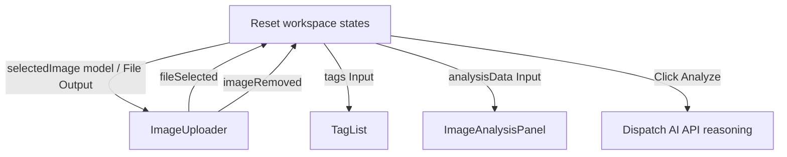

# Design System: Hybrid Image Analysis (Firebase AI Logic)

This document outlines the design system, brand identity, and structural layout for the **Hybrid Image Analysis** application, as extracted from the design tokens and the **Home Page** screen in the Stitch platform. The main design system configurations and Tailwind v4 theme block are located in [src/styles.css](file:///Users/connieleung/Documents/ws_jsangular2/ng-firebase-image-analyzer/src/styles.css).

---

## 1. Atmosphere & Brand Identity

The brand identity centers on **Firebase AI Logic**, projecting a sense of security, intelligence, and high-performance computing.

- **Aesthetic Tone**: Corporate, modern, and leaning heavily toward minimalism.
- **Visual Elements**:
  - **Precision Dot Grid**: A technical background dot grid (`logic-grid` using small repeated radial dots) representing structured logic.
  - **Gradients**: Muted radial color spots (`hero-gradient`) indicating focus and ambient lighting.
  - **Tactile Layers**: Clean, modern cards with a glassmorphism aesthetic (`glass-card`) using subtle borders and soft background blur.

---

## 2. Color Roles & Tokens

The color palette is built using Material Design 3 semantic color variables mapped to functional styling roles, backed by `:root` and `@theme` definitions in [src/styles.css](file:///Users/connieleung/Documents/ws_jsangular2/ng-firebase-image-analyzer/src/styles.css). All transparency is strictly declared using 8-digit hex notation (`#rrggbbaa`).

### Core Brand & Surface Roles

| Token Name                  | Hex Value | Role / Usage                                            |
| :-------------------------- | :-------- | :------------------------------------------------------ |
| `primary`                   | `#6366f1` | Primary branding, buttons, active interactive states    |
| `primary-container`         | `#6063ee` | High-visibility container background and gradient stops |
| `on-primary`                | `#ffffff` | High-contrast text on primary buttons and badges        |
| `secondary`                 | `#0f172a` | Authoritative text colors, tooltips, secondary elements |
| `secondary-container`       | `#dae2fd` | Soft secondary accents and containers                   |
| `surface` / `background`    | `#f8f9ff` | Application canvas backdrop                             |
| `surface-container`         | `#e5eeff` | Default cards and panels                                |
| `surface-container-high`    | `#ecf2ff` | Elevated surfaces and tag pills                         |
| `surface-container-highest` | `#d3e4fe` | Highest elevation surfaces                              |
| `on-surface`                | `#0b1c30` | Main text color on surfaces                             |
| `on-surface-variant`        | `#464554` | Subdued descriptive text                                |
| `outline`                   | `#767586` | Low-contrast borders and lines                          |
| `outline-variant`           | `#c7c4d7` | Muted division lines                                    |

### Semantic Error & Glassmorphism Tokens

| Token Name                  | Hex Value   | Role / Usage                                 |
| :-------------------------- | :---------- | :------------------------------------------- |
| `error`                     | `#ef4444`   | High-visibility alert states and error icons |
| `error-container`           | `#ef44441a` | 10% opacity backdrop for error banners       |
| `error-border`              | `#ef444433` | 20% opacity border for error containers      |
| `error-text`                | `#fca5a5`   | Error banner headline and label text         |
| `error-text-muted`          | `#f87171`   | Secondary error messages                     |
| `surface-glass`             | `#ffffffb3` | 70% opacity light mode glass card background |
| `surface-glass-border`      | `#d3e4fe80` | 50% opacity subtle glass panel border        |
| `surface-glass-dark`        | `#0f172a99` | 60% opacity dark mode glass surface          |
| `surface-glass-border-dark` | `#94a3b81a` | 10% opacity dark mode glass border           |
| `skeleton`                  | `#e2e8f0`   | Light mode placeholder loading shimmer       |
| `skeleton-dark`             | `#334155`   | Dark mode placeholder loading shimmer        |

---

## 3. Typography Scales

Typography uses a zero-dependency 2-tier system font hierarchy designed to maximize rendering speed and eliminate network font downloads:

1. **`--font-sans`** (`'Inter', ui-sans-serif, system-ui, sans-serif`): Headlines, display banners, and body text.
2. **`--font-mono`** (`ui-monospace, SFMono-Regular, Menlo, Monaco, Consolas, monospace`): Numeric metrics, badges, code blocks, and streaming status text.

### Scales

- **`display-lg`** (Hero Heading)
  - **Font Family**: `--font-sans`
  - **Size**: `64px`
  - **Line Height**: `1.1`
  - **Font Weight**: `700`
  - **Letter Spacing**: `-0.02em`
- **`headline-lg`** (Primary Headings)
  - **Font Family**: `--font-sans`
  - **Size**: `40px`
  - **Line Height**: `1.2`
  - **Font Weight**: `600`
  - **Letter Spacing**: `-0.01em`
- **`headline-md`** (Secondary Headings)
  - **Font Family**: `--font-sans`
  - **Size**: `24px`
  - **Line Height**: `1.4`
  - **Font Weight**: `500`
- **`body-lg`** (Lead Paragraphs)
  - **Font Family**: `--font-sans`
  - **Size**: `18px`
  - **Line Height**: `1.6`
  - **Font Weight**: `400`
- **`body-md`** (Default Body Text)
  - **Font Family**: `--font-sans`
  - **Size**: `16px`
  - **Line Height**: `1.6`
  - **Font Weight**: `400`
- **`label-md`** (Buttons and Navigation Labels)
  - **Font Family**: `--font-mono`
  - **Size**: `14px`
  - **Line Height**: `1.2`
  - **Font Weight**: `500`
  - **Letter Spacing**: `0.05em`
- **`code-sm`** (Monospace Text)
  - **Font Family**: `--font-mono`
  - **Size**: `13px`
  - **Line Height**: `1.5`
  - **Font Weight**: `400`

---

## 4. Structural Layouts & Spacing Scale (Home Page)

The layout of the Home Page leverages standard Tailwind CSS v4 dynamic spacing rules and CSS Grid/Flexbox to establish structured spatial relationships:

### Grid & Alignments

- **Desktop Grid**: 12-column layout with responsive gap spacing (`gap-10 md:gap-16` on container, transitioning to grid columns for desktop).
- **Max Width**: Standard application boundaries locked to `1280px` (`max-w-container-max` / `max-w-7xl`).
- **Spatial & Sizing Scale**: Standard Tailwind v4 dynamic 4px-base scale (`gap-2` = 8px, `gap-4` = 16px, `px-6` = 24px, `py-8` = 32px, `py-12` = 48px, `py-16` = 64px). Non-standard `--spacing-sm/md/lg` theme overrides are omitted to preserve standard container sizing utilities (`max-w-sm` = 384px, `max-w-md` = 448px).

### Main Page Sections

1. **Top Navigation Bar (`nav`)**:
   - Fixed position at the top (`fixed top-0 w-full z-50`).
   - Primary background (`bg-primary`) with horizontal alignment (`h-16 px-6 max-w-container-max mx-auto`).
   - Navigation links using standard typography and active highlight indicator.
2. **Hero Section (`section`)**:
   - **Layout Structure**: Full-width container (`.hero-container`: `w-full max-w-7xl mx-auto px-6 grid grid-cols-1 md:grid-cols-12 gap-10 md:gap-16 items-center py-12 md:py-16`).
   - **Background & Accent Styles**:
     - `.hero-gradient`: Radial ambient glow (`radial-gradient(circle at 50% 50%, #4648d40d 0%, #f8f9ff00 70%)`).
     - `.logic-grid`: Radial dot grid backdrop pattern (`background-image: radial-gradient(circle, var(--color-surface-container) 1px, transparent 1px); background-size: 24px 24px;`).
     - Minimum height: `min-h-[90vh]`.
   - **Left Side Column (`md:col-span-7 space-y-6 md:space-y-8 min-w-0`)**:
     - **Display Headline**: `Intelligent Inference. Anywhere.` (`text-5xl lg:text-6xl font-bold tracking-tight leading-tight text-on-surface`), where "Anywhere." is styled with the primary color (`text-primary`).
     - **Subhead description**: `Deploy hybrid AI logic across cloud and edge with Firebase. Real-time image analysis, on-device privacy, low token costs, and cloud-scale power.` (`text-lg text-on-surface-variant leading-relaxed max-w-[36rem]`).
     - **Primary CTA Button**: `Get Started` accompanied by the standalone SVG icon component `<app-arrow-forward-icon>`. Sizing/styling: `bg-white text-primary px-8 py-3.5 rounded-xl font-semibold text-lg inline-flex items-center gap-2 transition-all shadow-lg hover:bg-surface-container`.
   - **Right Side Column (`md:col-span-5 relative w-full min-w-0 max-w-md md:max-w-none mx-auto`)**:
     - **Illustration Container**: A pulse-animated wrapper with hover scale (`animate-pulse transition-all duration-1000 hover:scale-[1.02]`).
     - **Optimized Hero Image**: Next-generation WebP asset loaded via Angular's `NgOptimizedImage` (`ngSrc="/images/home.webp"`, `width="512"`, `height="382"`, `priority`), preserving zero-CLS layout stability and responsive fluid aspect ratio (`aspect-ratio: 512 / 382`).
     - **Decorative Floating Blurs**:
       - Top-Right: `absolute -top-6 -right-6 w-32 h-32 bg-secondary-container/30 rounded-full blur-3xl`.
       - Bottom-Left: `absolute -bottom-8 -left-8 w-48 h-48 bg-primary-container/20 rounded-full blur-3xl`.
3. **Footer (`footer`)**:
   - Primary background with structured responsive flex layout (`py-8 px-6 gap-4`) grouping branding items and license/credits text.

---

## 5. Streaming Loader & Progressive Visual States

To accommodate the shift from standard blocking operations to real-time generative streams, the design system defines a set of micro-interactions and progressive layouts to keep the user interface feeling responsive, fluid, and premium.

### 5.1 The Glassmorphic Streaming Loader Badge (`.streaming-loader-badge`)

Rather than covering the screen with a destructive full-page blocking overlay, we use an in-situ glassmorphic status badge to keep the background workspace visible and alert the user to incoming real-time tokens:

- **Aesthetic & Token Properties**:
  - **Backdrop Blur**: `backdrop-filter: blur(12px)` for maximum glass transparency.
  - **Background Spot**: Semitransparent fill (`var(--color-surface-glass)`, `#ffffffb3` / dark `#0f172a99`) overlaid with a primary highlight tint.
  - **Borders**: `1px solid var(--color-surface-glass-border)` (`#d3e4fe80` / dark `#94a3b81a`) to define a clean, low-contrast, premium outline.
  - **Shadow**: Subtle, diffuse shadow (`var(--shadow-primary-glow)` / `0 4px 20px -2px #4648d414`).
  - **Spacing**: Symmetrical inline padding (`px-4 py-2` or `sm`/`md` scale).
- **Micro-Animations**:
  - **Pulsing State**: A continuous, high-comfort scale pulse (`scale-[1.01]` transition with standard bezier timing) to evoke intelligence.
  - **Sync Spinner**: Standard infinite rotation (`animate-spin` over `1.5s`) of the standalone `<app-sync-icon>` in the primary color (`#4648d4`).

### 5.2 Progressive Content Reveal Animation (`.animate-fade-in`)

To ensure streaming text and UI cards do not pop onto the canvas in a jarring, static manner, all progressive elements (including newly rendered tag lists and analysis cards) use the global `animate-fade-in` utility defined in `src/styles.css`:

```css
@keyframes fadeIn {
  from {
    opacity: 0;
    transform: translateY(10px);
  }
  to {
    opacity: 1;
    transform: translateY(0);
  }
}

@utility animate-fade-in {
  animation: fadeIn 0.35s cubic-bezier(0.16, 1, 0.3, 1) forwards;
}
```

This progressive approach maintains typographic rhythm and ensures the UI feels exceptionally natural and modern under progressive data conditions.

### 5.3 CLS-Safe On-Device Pre-Warming Status Slot (`.prewarm-status-slot` & `.prewarm-status-badge`)

When `ImageAnalysisComponent` triggers background Gemini Nano pre-warming after initial render (`afterNextRender`), a dedicated status slot sits directly below `<app-image-uploader>` to communicate background shader compilation without blocking upload or analysis controls or shifting page layout:

- **Zero-CLS Layout Slot (`.prewarm-status-slot`)**:
  - `.workspace-container`: `@apply space-y-6 max-w-(--spacing-container-max) mx-auto px-4 py-8;` with `.workspace-container > app-image-uploader { @apply mb-0; }`.
  - `.prewarm-status-slot`: `@apply min-h-9 my-0 flex items-center justify-center;`
  - Reserves a fixed minimum height (`min-h-9` / `36px`) with zero vertical margin (`my-0`) and `role="status"` / `aria-live="polite"`, acting as the single spacing gap between `<app-image-uploader>` and the next workspace element so mounting and unmounting `.prewarm-status-badge` produces `0.000` Cumulative Layout Shift (CLS) without excess whitespace.
- **Glassmorphic Pre-Warming Pill (`.prewarm-status-badge`)**:
  - `@apply inline-flex items-center gap-2.5 px-4 py-1.5 rounded-full border transition-opacity duration-300 ease-out;`
  - **Light Mode Surface**: `background: var(--color-surface-glass)` (`#ffffffb3`) and `border-color: var(--color-surface-glass-border)` (`#d3e4fe80`) with `backdrop-filter: blur(12px)`.
  - **Dark Mode Surface (`:host-context(.dark) .prewarm-status-badge`)**: `background: var(--color-surface-glass-dark)` (`#0f172a99`) and `border-color: var(--color-surface-glass-border-dark)` (`#94a3b81a`).
- **Spinner & Status Typography (`.prewarm-status-icon` & `.prewarm-status-text`)**:
  - `.prewarm-status-icon`: `<app-sync-icon>` styled with `@apply w-4 h-4 animate-spin motion-reduce:animate-none text-primary shrink-0;` (`--color-primary`).
  - `.prewarm-status-text`: Monospace status label styled with `@apply text-xs font-semibold tracking-wide text-(--color-on-surface-variant) font-mono;` (`--color-on-surface-variant`).

---

## 6. Image Analysis Feature Architecture

The Image Analysis workspace orchestrates the `ImageUploader`, `TagList`, and `ImageAnalysisPanel` into a cohesive, responsive workspace with progressive streaming support.

### 6.1 Orchestration Architecture



### 6.2 Advanced Analysis Panel (4-Tab Control System)

The results section employs a 4-tab control system allowing users to deep-dive into multi-modal metadata:

1. **Thought Summary**:
   - Card utilizing glassmorphic aesthetics (`var(--color-surface-glass)` and `var(--color-surface-glass-border)`).
   - Presents AI reasoning steps, model confidence scores, and structured insights (e.g. breed detection, environmental context, lighting conditions).
2. **Recommendations List**:
   - Structured list of composition, visual, and lighting suggestions (e.g. cropping guidelines, color balance shifts).
   - Uses high-contrast typography labels (`font-headline-sm`) and secondary supporting descriptions (`text-on-surface-variant`).
3. **Token Usage Analytics**:
   - **Stacked Progress Bar**: Custom horizontal compound bar displaying relative ratio of:
     - **Input Tokens** (`var(--color-primary)`)
     - **Output Tokens** (`var(--color-secondary)`)
     - **Cached Tokens** (`var(--color-tertiary)`)
     - **Thought/Reasoning Tokens** (`var(--color-primary-container)`)
   - Detailed breakdown charts illustrating prompt modality details (text vs. image), output details, and cache status with precise numeric counts.
4. **Image Improvement (AI Enhanced Preview)**:
   - **Metadata Sidebar**: Column displaying crop coordinates/aspect ratios and precise filtering metadata (brightness, saturation, contrast adjustments).
   - **Enhanced Canvas**: Interactive high-fidelity preview showing the filtered/cropped output with download capability.

---

## 7. Accordion Component System

The Accordion Component System defines the structural layout, interactive behavior, and visual tokens for the single-expansion disclosure pattern displaying culinary dishes and recipe synthesis details.

### 7.1 Visual Tokens & Glassmorphic Container

- **Styling Tokens & Classes**: `glass-card`, `surface-glass`, `surface-glass-border`, `rounded-2xl`
- **Surface Elevation**: Semi-transparent background (`var(--color-surface-glass)`) with subtle outline border (`var(--color-surface-glass-border)`) and `16px` rounded corners (`rounded-2xl`).
- **Interactive Transitions**: Smooth transition on focus and hover, maintaining elevation without breaking the ambient dot grid background.

### 7.2 Responsive Header Typography & Indicators

The accordion header provides instant scannability for dishes in both collapsed and expanded states:

- **English Title**: Primary headline styled with `font-semibold text-lg text-on-surface`.
- **Native Script Pill Badge**: Secondary cultural context badge styled with `font-mono text-xs px-2 py-0.5 rounded-full bg-surface-container-high text-on-surface-variant`.
- **Line-Clamped Description**: Supporting description clamping to 2 lines on mobile screens and expanding on desktop: `text-sm text-on-surface-variant line-clamp-2 md:line-clamp-none`.
- **Right-Aligned Rotating Chevron**: State indicator with `transition-transform duration-200` (e.g., `rotate-180` when expanded).

### 7.3 Responsive Panel Body Layout & Scroll Boundaries

The expanded disclosure body (`.dish-body` in `culinary-dish-list.component.css`) arranges synthesis details, markdown recipe content, and telemetry diagnostics in a vertical flex stack:

- **Outer Disclosure Body (`.dish-body`)**: `@apply flex flex-col gap-6 pt-4 max-h-[60vh] md:max-h-[70vh] overflow-y-auto overscroll-contain;`
- **Top 2-Column Content Grid (`.dish-content-grid`)**:
  - **Mobile Layout**: Single-column vertical stack (`grid-cols-1`) displaying ingredients followed by cooking instructions.
  - **Desktop Layout**: Two-column grid (`md:grid-cols-[2fr_3fr]`, a **2:3 / 40% : 60% ratio**) separating the left ingredients column (`40%`) and right cooking instructions column (`60%`): `@apply grid grid-cols-1 md:grid-cols-[2fr_3fr] gap-6 items-start;`
- **Recipe Instructions Wrapping (`.dish-instructions`)**:
  - `@apply space-y-4 min-h-[160px] min-w-0 wrap-break-word [&_pre]:whitespace-pre-wrap [&_pre]:font-sans [&_code]:whitespace-pre-wrap [&_code]:font-sans;` ensuring markdown blocks and code elements wrap properly without horizontal clipping.
- **Full-Width Bottom Diagnostics Row**:
  - `<app-token-analytics>` is wrapped in `@defer (when recipeDetail?.tokenSummary)` with `<app-skeleton variant="line" [lines]="2" class="w-full" />` inside `@placeholder`. It is placed outside and below `.dish-content-grid` so it spans the full width (`100%`) of `.dish-body` beneath both the Ingredients and Recipe columns.

### 7.4 Semantic Content Projection Slots

To decouple accordion wrapper state from specific recipe rendering logic, the component exposes distinct semantic projection slots:

- `<accordion-header>` (or `<ng-content select="accordion-header" />` / `select="[accordion-header]"`): Header trigger slot for dish title, native script pill badge, and rotating chevron.
- `<accordion-body>` (or `<ng-content select="accordion-body" />` / `select="[accordion-body]"`): Collapsible disclosure panel containing streamed recipe synthesis content, ingredients sidebar, and token diagnostics.

---

## 8. Culinary Destination Selector & Autocomplete System

The Culinary Destination Selector provides a responsive, accessible destination filter for initiating Stage 1 Culinary Discovery.

### 8.1 Visual Architecture & Layout Tokens

- **Responsive Container**: Mobile-first flex container (`flex flex-col sm:flex-row gap-3 items-center`) that stacks vertically on narrow viewports and aligns into a unified search bar on tablet/desktop.
- **Glassmorphic Styling**: Card container styled with `glass-card`, `surface-glass`, `surface-glass-border`, and `rounded-2xl`.
- **Form Controls & Component Stylesheet (`culinary-search-box.component.css`)**:
  - `@reference "../../../../styles.css";`
  - `:host`: `@apply relative z-20 block;`
  - `.search-box-card`: `@apply relative z-20 p-4 md:p-6 rounded-2xl backdrop-blur-md bg-surface-glass border border-surface-glass-border dark:bg-surface-glass-dark dark:border-surface-glass-border-dark shadow-sm;`
  - `.search-form`: `@apply flex flex-col sm:flex-row gap-3 items-stretch sm:items-center w-full;`
  - `.form-group`: `@apply flex flex-col gap-1.5 flex-1 relative;`
  - `.form-label`: `@apply text-xs font-semibold tracking-wider uppercase text-on-surface-variant;`
  - `.select-control`: `@apply w-full px-4 py-2.5 rounded-xl border border-outline/30 bg-surface text-on-surface focus:outline-none focus:ring-2 focus:ring-primary/50 transition-all;`
  - `.input-control`: `@apply w-full px-4 py-2.5 rounded-xl border border-outline/30 bg-surface text-on-surface focus:outline-none focus:ring-2 focus:ring-primary/50 transition-all placeholder:text-outline;`
  - `.listbox-overlay`: `@apply absolute left-0 right-0 top-full mt-1.5 max-h-56 overflow-y-auto rounded-xl border border-outline-variant bg-surface-container-high shadow-lg z-50 p-1 list-none m-0;`
  - `.listbox-option`: `@apply px-3.5 py-2 rounded-lg text-sm text-on-surface cursor-pointer select-none transition-colors hover:bg-surface-container-highest;`
  - `.listbox-option-active`: `@apply bg-primary/10 text-primary font-medium;`
  - `.submit-btn`: `@apply px-6 py-2.5 rounded-xl bg-primary text-on-primary font-semibold text-sm transition-all shadow-md hover:bg-primary-container disabled:opacity-50 disabled:cursor-not-allowed sm:self-end;`

### 8.2 WAI-ARIA 1.2 Combobox Pattern

The city autocomplete combobox conforms to WAI-ARIA 1.2 specifications for typeahead listboxes:

- **Combobox Container / Input**:
  - `role="combobox"`: Declares the input as a combobox.
  - `aria-autocomplete="list"`: Indicates that typing filters a list of suggested values.
  - `aria-expanded="true | false"`: Reflects the open/closed state of the suggestions listbox overlay.
  - `aria-controls="city-listbox-id"`: References the popup listbox element ID.
  - `aria-activedescendant="city-option-{index}"`: Points to the currently highlighted item during keyboard navigation.
- **Popup Listbox Overlay**:
  - `role="listbox"`: Applied to the suggestions container.
  - `id="city-listbox-id"`: Anchored target for `aria-controls`.
  - `aria-label="Suggested cities"`: Accessible name for screen readers.
- **Option Elements**:
  - `role="option"`: Applied to each suggestion row.
  - `id="city-option-{index}"`: Dynamic ID matching `aria-activedescendant`.
  - `aria-selected="true | false"`: Indicates the currently active/selected suggestion.

### 8.3 Keyboard Navigation Matrix

| Key         | Trigger Context              | Interaction & State Response                                                                                                                  |
| :---------- | :--------------------------- | :-------------------------------------------------------------------------------------------------------------------------------------------- |
| `ArrowDown` | Input focused / Listbox open | Prevents input caret jump, moves highlight to next option (opens listbox if closed), and scrolls active option into view (`block: 'nearest'`) |
| `ArrowUp`   | Input focused / Listbox open | Prevents input caret jump, moves highlight to previous option (wraps at top), and scrolls active option into view (`block: 'nearest'`)        |
| `Enter`     | Highlighted option active    | Selects highlighted city, updates form model, and closes listbox                                                                              |
| `Enter`     | No highlight / Valid form    | Submits form and emits `search` location payload                                                                                              |
| `Escape`    | Listbox open                 | Closes suggestions listbox without modifying current input                                                                                    |
| `Tab`       | Any control                  | Advances focus to next element and closes open suggestions overlay                                                                            |

### 8.4 Strict Dataset Validation & Submission States

To ensure generative AI discovery pipelines are never invoked with hallucinated or non-existent geographic destinations:

- **Strict Dataset Guard**: The city value in the form model MUST match an exact entry within the selected country's destination dataset (`DestinationDataset.data.find(c => c.country === selectedCountry).cities`).
- **Disabled State**: The Search submit button is strictly disabled (`disabled` attribute and `aria-disabled="true"`) whenever:
  1. The dataset is empty or loading.
  2. The typed city query does not match any valid city in the active country.
- **Explicit Submission**: Selection changes never auto-trigger discovery; inference requests are dispatched exclusively on explicit form submission (`Enter` or Search button click).

---

## 9. Culinary Guide Layout & Responsive State Architecture

The Culinary Guide feature workspace orchestrates `CulinarySearchBoxComponent`, `CulinaryDishListComponent`, and `CulinaryDiscoveryPanelComponent` into a cohesive, responsive page with progressive AI discovery and recipe synthesis.

### 9.1 Visual Architecture & Layout Tokens

- **Responsive Full-Height Flex Container**:
  - Container class: `.culinary-guide-container`
  - Max width & auto-centering: `max-w-(--spacing-container-max) mx-auto`
  - Vertical flex column & minimum viewport height: `flex flex-col gap-8 min-h-[calc(100vh-8rem)] px-4 py-8`
  - Middle dish-list section wrapper uses `flex-1` so the bottom discovery panel is anchored toward the bottom of the workspace even when the dish list is collapsed or displaying a placeholder card.
- **Component Stylesheet (`culinary-guide.component.css`)**:
  - `@reference "../../../styles.css";`
  - `.culinary-guide-container`: `@apply flex flex-col gap-8 min-h-[calc(100vh-8rem)] max-w-(--spacing-container-max) mx-auto px-4 py-8;`
  - `.culinary-dish-section`: `@apply flex-1;`

### 9.2 Search Loading State & Race Condition Prevention

- **Search Loading Indicator**:
  - `isDiscovering` signal tracks the active Stage 1 discovery stream in `CulinaryGuideComponent`.
  - Passed via `[isLoading]="isDiscovering()"` into `CulinarySearchBoxComponent`.
  - Displays `<app-spinner-icon class="animate-spin text-on-primary w-4 h-4 mr-2" />` inside the submit button while disabling interaction (`[disabled]="isSearchDisabled()"`).
- **Sequential Race Condition Guard (`#searchId`)**:
  - Native private counter `#searchId` ensures out-of-order or late chunks from previous destination searches are strictly ignored when a user submits a newer query before the older stream terminates.
  - Reset of `expandedDishNames` and `recipes` occurs on the first chunk received for the current search.
  - Error fallback to `DEFAULT_DISCOVERY_DATA` is guarded by `#searchId` to avoid overwriting a subsequent successful search.
