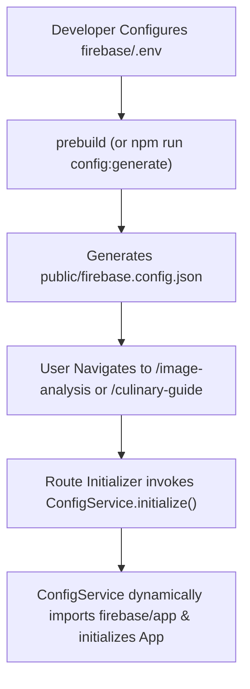

# NgFirebaseImageAnalyzer 🧠🖼️

A high-performance, minimalist Angular 22 single-page application demonstrating **Hybrid Image Analysis** powered by **Firebase AI Logic**. The application is designed to prioritize on-device WebGPU execution (using Gemini Nano) for offline, privacy-first tasks, and falls back dynamically to Cloud-scale Vertex AI models when WebGPU is unavailable or when the client is offline.

The application features a clean, responsive layout styling leveraging modern Tailwind CSS v4, precision logic backgrounds, ambient glowing backdrops, and glassmorphic panels.

---

## 🚀 Key Features

- **Hybrid Inference Engine**: Smart routing between client-side WebGPU (Gemini Nano) and Cloud (Vertex AI) based on browser capabilities and network connectivity.
- **Culinary Guide**: Two-stage **Culinary Discovery** (top iconic dishes and honorable mentions) and on-demand **Recipe Synthesis** with streaming JSON repair.
- **Live Performance Audits**: Visual, high-fidelity latency and **Modality Tokens** monitoring of inference cycles.
- **Visual Enhancer Panel**: Adjusts contrast, brightness, and structure of analysed images.
- **App Check Sandbox Support**: Built-in localhost sandbox support to bypass reCAPTCHA Enterprise requirements during local development.

---

## 🛠️ Tech Stack

- **Framework**: Angular v22 (Reactive Signals, Computed properties, functional Dependency Injection `@Service()`)
- **Styling**: Tailwind CSS v4 & PostCSS (Hanken Grotesk, Inter, and Geist font scales)
- **AI Integration**: Firebase JS SDK `v13.0.0` (`firebase/ai`, `firebase/app-check`, & `firebase/remote-config`)
- **Testing & Build Pipeline**: Vitest, Node-based prebuild configuration pipeline, ESLint, Prettier, Husky, Commitlint

---

## 📋 Prerequisites

- **Browser**: Desktop **Google Chrome 148+** (where the built-in Gemini Nano Prompt API is stable out of the box) with WebGPU support.
- **Runtime**: **Node.js `>= 20.12.0`** (required for native `process.loadEnvFile()`).

---

## 🔥 Firebase Project & AI Logic Setup

If you do not have a Firebase project configured yet, follow these steps:

1. **Create a Firebase Project**:
   - Go to the [Firebase Console](https://console.firebase.google.com) and click **Create a project**.
2. **Register a Web App**:
   - In your project overview, click the **Web (`</>`)** icon to add a web app.
   - Register the app (Firebase Hosting setup is optional at this step) and copy the `firebaseConfig` keys (`apiKey`, `authDomain`, `projectId`, `storageBucket`, `messagingSenderId`, `appId`).
3. **Enable Firebase AI Logic**:
   - In the left sidebar, navigate to **AI > Firebase AI Logic** and click **Get started**.
   - This repository uses `AgentPlatformBackend` (**Vertex AI Gemini API**) by default so it works reliably across regions (including Hong Kong without a VPN). To enable the Vertex AI provider, upgrade your Firebase project to the **Blaze (pay-as-you-go) plan** and enable the Vertex AI Gemini API in the console prompt.

> [!TIP]
> **Using the Free Tier (Regions Supporting Gemini Developer API, e.g., Malaysia):**
> If you are in a region where the **Gemini Developer API** is supported without a VPN, you can stay on the free **Spark (no-cost) plan**:
>
> 1. Enable the **Gemini Developer API** in the Firebase AI Logic console.
> 2. In `src/app/core/firebase/config.service.ts`, replace `AgentPlatformBackend` with `GoogleAIBackend`:
>
>    ```typescript
>    const { getAI, GoogleAIBackend } = await import('firebase/ai');
>    this.#ai = getAI(app, {
>      backend: new GoogleAIBackend(),
>      useLimitedUseAppCheckTokens: this.#appConfig.useLimitedUseAppCheckTokens,
>    });
>    ```

---

## 📦 Dependency Installation

To install all dependencies for both the Angular application and the build environment, run:

```bash
npm install
```

---

## 🔑 Environment Configuration & Angular Startup Flow

This repository uses a custom Node.js script to dynamically generate Firebase configuration files.

> [!IMPORTANT]
> The environment variable file `.env` **must** be created inside the `firebase/` subdirectory—**not** the root of the project.

### Step 1: Create the `.env` file

Duplicate the provided `.env.example` inside the `firebase/` folder:

```bash
cp firebase/.env.example firebase/.env
```

### Step 2: Set your credentials

Open `firebase/.env` and supply the Firebase keys from your Web App configuration:

```env
FIREBASE_API_KEY="your-api-key"
FIREBASE_AUTH_DOMAIN="your-auth-domain"
FIREBASE_PROJECT_ID="your-project-id"
FIREBASE_STORAGE_BUCKET="your-storage-bucket"
FIREBASE_MESSAGING_SENDER_ID="your-sender-id"
FIREBASE_APP_ID="your-app-id"
FIREBASE_RECAPTCHA_ENTERPRISE_KEY="your-recaptcha-key"
FIREBASE_APPCHECK_DEBUG_TOKEN=""
```

> [!NOTE]
> Firebase App Check is required. For local development on `localhost`, you can leave `FIREBASE_APPCHECK_DEBUG_TOKEN=""` blank—[`ConfigService`](file:///Users/connieleung/Documents/ws_jsangular2/ng-firebase-image-analyzer/src/app/core/firebase/config.service.ts#L33-L37) automatically falls back to `globalThis['FIREBASE_APPCHECK_DEBUG_TOKEN'] = true`, which prints a temporary debug token in the browser DevTools console that you register in **Firebase Console > App Check > Apps > Manage debug tokens** (see [Firebase App Check Setup] below).

### Step 3: Point Firebase CLI to your project & generate config

Set your active Firebase project ID inside the `firebase/` directory (used by `prebuild` and `config:fetch` to pull Remote Config parameters):

```bash
cd firebase && npx firebase use your-project-id && cd ..
```

When running `npm run build` or `npm run preview`, the `prebuild` script (`node firebase/scripts/prebuild.js`) automatically generates `public/firebase.config.json` and fetches Remote Config defaults. If you want to start the dev server (`npm run start`) directly on a fresh clone, generate `public/firebase.config.json` once first:

```bash
npm run config:generate
```

### 🔄 How Configuration Powers Angular Startup

To keep the initial application bundle fast and decoupled, the application uses **Deferred AI Initialization** and **Staged Firebase Loading**:



When entering an AI-powered route (`/image-analysis` or `/culinary-guide`), the `ConfigService` (`src/app/core/firebase/config.service.ts`) reads the generated JSON:

```typescript
import firebaseConfig from '@/public/firebase.config.json';
```

And dynamically imports `firebase/app` and `firebase/remote-config` to initialize the Firebase App object on demand:

```typescript
this.#app = initializeApp(firebaseConfig.app);
```

Without `public/firebase.config.json`, the Angular application will fail to compile or initialize the AI Logic client.

---

## 💻 Run and Build Commands

The project provides npm scripts to run, test, and build the application in various environments:

| Command                    | Action                                                                      | URL / Port              |
| :------------------------- | :-------------------------------------------------------------------------- | :---------------------- |
| `npm run start`            | Launches local Angular development server with Hot Module Replacement (HMR) | `http://localhost:4200` |
| `npm run build`            | Runs prebuild config generators and compiles production build               | Output: `dist/`         |
| `npm run preview`          | Runs the compiled production build locally on a fixed port                  | `http://localhost:5005` |
| `npm run preview:emulator` | Runs the compiled production build on a dynamic emulator-assigned port      | `$PORT`                 |
| `npm run firebase:emulate` | Runs the application using the local Firebase App Hosting Emulator          | `http://localhost:5005` |
| `npm run test`             | Executes unit tests with the Vitest test runner                             | -                       |
| `npm run lint`             | Runs eslint across codebase                                                 | -                       |
| **Pipeline Utilities:**    |                                                                             |                         |
| `npm run config:fetch`     | Manually fetches the Firebase Remote Config parameters as local defaults    | -                       |
| `npm run config:generate`  | Manually parses `.env` to generate public-facing `firebase.config.json`     | -                       |

### 🔄 Local Emulation vs. Rapid Development Workflow

When working locally, you have two distinct execution modes depending on your immediate objective:

#### 1. Rapid Feature Development (90% of your time)

- **Command**: `npm run start` (which triggers `ng serve`)
- **URL**: `http://localhost:4200`
- **How it works**: Runs the standard Angular development server with **Hot Module Replacement (HMR)** and dynamic compilation in under a second.
- **Best for**: Adjusting UI layouts, tweaking styles, writing component logic, and fast iterative coding.
- **Why not use the emulator?**: Serving production-like emulators requires compiling the full optimized bundle (`ng build`) on every single file save, disabling hot-reloading and slowing your iteration loop down to 10–15 seconds per edit.

#### 2. High-Fidelity Pre-Deployment Emulation (Before Pushing to Git)

- **Command**: `npm run firebase:emulate`
- **URL**: `http://localhost:5005`
- **How it works**: The Local Emulator Suite boots your application using the configured `startCommand` inside `firebase/firebase.json`.
- **Fidelity Optimization**: By default, the emulator is configured with `"startCommand": "npm run start"` for rapid local startup. To verify your optimized production assets, lazy-loaded chunk resolutions, environment variables, security rules, and PWA Service Workers before pushing, simply toggle the `startCommand` in `firebase.json` to point to `"npm run preview:emulator"`!

---

## 🛡️ Firebase App Check Setup

Firebase App Check protects your API resources from abuse. In this project, it is secured using **reCAPTCHA Enterprise**.

### Generating a reCAPTCHA Enterprise Key (Production)

1. Navigate to the **reCAPTCHA Enterprise** page in the [Google Cloud Console](https://console.cloud.google.com).
2. Click **Create Key**.
3. Set a display name (e.g., `ng-firebase-image-analyzer-prod`).
4. Select the **Web** platform type.
5. Under **Allowed Domains**, add your production domain names (e.g., `your-app-domain.web.app`).
6. Save the key and copy the generated **Key ID**.
7. Assign this Key ID to `FIREBASE_RECAPTCHA_ENTERPRISE_KEY` inside your environment configuration.

### Local Debugging & App Check Sandbox

To ensure local builds running via `localhost` (such as `npm run start`, `npm run preview`, or `npm run firebase:emulate`) bypass reCAPTCHA validation without failing, the app configures `FIREBASE_APPCHECK_DEBUG_TOKEN = true` under developer/localhost preview environments.

1. Run the application locally in dev or preview mode.
2. Open your browser's developer console (F12).
3. Search for a console log from Firebase App Check containing a temporary debug token:
   `App Check debug token: <debug token>`
4. Copy this debug token.
5. In the [Firebase Console](https://console.firebase.google.com), navigate to **App Check > Apps**.
6. Select your Web app, click the overflow menu (three dots), and select **Manage debug tokens**.
7. Click **Add debug token**, paste your copied token, and save.
8. _(Optional — Locked Mode)_ Paste the registered token into `FIREBASE_APPCHECK_DEBUG_TOKEN` inside `firebase/.env` so it persists across browser data resets.

---

## ☁️ Firebase App Hosting Deployment

This application is built for seamless deployment using **Firebase App Hosting**.

- **Runtime Configuration**: The deployment configuration is defined in `apphosting.yaml`. It limits active instances (`minInstances: 0`, `maxInstances: 2`) to ensure optimal control over Google Cloud compute costs.
- **Build Pipeline Integration**: Upon pushing changes to your Git repository, Firebase App Hosting automatically executes `npm run build` which invokes the `prebuild` phase (`node firebase/scripts/prebuild.js`) to generate configurations from environment variables securely at compile time.
